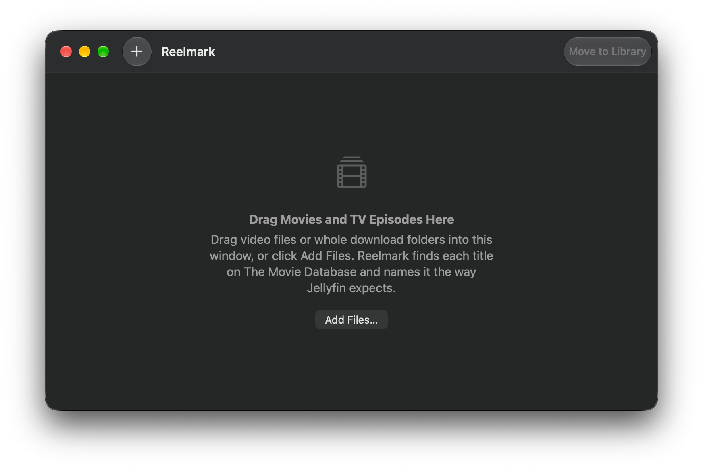

# Reelmark

**Rename downloaded movies and TV episodes for Jellyfin, on your Mac.**

[](https://github.com/MineGene/reelmark/releases/latest)
[](#requirements)
[](LICENSE)



Drag in a download, and Reelmark looks it up on [The Movie Database](https://www.themoviedb.org) (TMDB). It then copies it into your Jellyfin library with exactly the folder and file names Jellyfin expects:

```
Movies/Dune - Part Two (2024) [tmdbid-693134]/Dune - Part Two (2024) [tmdbid-693134].mkv
Shows/Severance (2022) [tmdbid-95396]/Season 01/Severance S01E02.mkv
```

The TMDB id in each folder name tells Jellyfin exactly which title it is, so remakes, shows with the same name and foreign titles never get mixed up.

## Features

- **Drag and drop:** single files or whole download folders. Sample clips and hidden files are skipped.
- **Movies and TV:** handles episodes, seasons and multi-episode files (`S01E01-E02`), including season folders like `Show/Season 2/Episode 03.mkv`.
- **You stay in control:** check every match before anything happens, choose a different match from a list, or search again by hand.
- **Copy or move:** Copy is the default, so your torrent client can keep seeding. On the same drive, a copy takes no extra space.
- **Safe:** never overwrites and never deletes anything. Edit ▸ Undo reverses the last Copy or Move, as in Finder.
- **Nothing to set up:** no account, sign-in or API key needed.
- **A real Mac app:** standard macOS controls, light and dark mode, VoiceOver, and a Liquid Glass icon.
- **Free and open source:** MIT licensed, with no tracking and no ads.

## Requirements

- A Mac with Apple silicon
- macOS 26 or later
- A Jellyfin library with separate Movies and Shows folders, on this Mac or a drive it can reach

## Install

1. Download the DMG from the [latest release](https://github.com/MineGene/reelmark/releases/latest), open it and drag Reelmark to Applications.
2. Reelmark is free and isn't notarised by Apple (that needs a paid developer account), so macOS blocks it until you say you trust this copy. Open **Terminal**, run this once, then open Reelmark as usual:

   ```sh
   xattr -dr com.apple.quarantine /Applications/Reelmark.app
   ```

   You'll need to do this once for each new version. Rather not use Terminal? Open Reelmark, then go to **System Settings › Privacy & Security**, scroll down, click **Open Anyway** and confirm.

## Using Reelmark

1. **Choose your library folders:** open **Reelmark › Settings** and choose your Jellyfin Movies and Shows folders. You only need to do this once.
2. **Add downloads:** drag video files or whole download folders into the window, or click **Add Files** (⌘O). Reelmark looks up each one on TMDB.
3. **Check the matches:** the New Name column shows where each file will go. If there's more than one possible match, pick the right one from the menu. To search with a different title, right-click and choose **Search Again…**.
4. **Copy to Library:** click **Copy to Library**, or **Move to Library** if you've chosen Move in Settings. **Clear** empties the list when you're done (your files aren't touched), and Delete removes just the selected items. Changed your mind? **Edit ▸ Undo** (⌘Z) puts moved files back and sends copies to the Trash, and **Edit ▸ Redo** (⇧⌘Z) files them again.

### Keyboard shortcuts

| Shortcut | Does |
| --- | --- |
| ⌘O | Add Files… |
| ⌘Return | Copy (or Move) to Library |
| ⌘R | Search Again… for the selected item |
| ⇧⌘R | Show the selected items in Finder |
| Delete or ⌘Delete | Remove the selected items from the list |
| ⌥⌘Delete | Clear the whole list |
| ⌘. | Stop adding files from a big folder |
| ⌘Z / ⇧⌘Z | Undo or redo the last Copy or Move to Library |
| ⌘A | Select everything in the list |
| ⌘, | Settings |

They're all in the File menu too, and right-clicking an item offers Search Again…, Show in Finder and Remove from List.

## Privacy

- **Only a title and year leave your Mac:** for example "Severance 2022", sent to TMDB's API. File names, folders and everything else stay on your Mac.
- **Nothing collected:** no analytics, no crash reporting, no update checks, and nothing about your files is logged or saved.
- **Sandboxed:** Reelmark can only touch the files you add and the two library folders you choose.
- **Declared the standard way:** Reelmark includes Apple's privacy manifest, which states that it doesn't track you and collects no data.
- **Checked automatically:** every build is tested for the exact permissions and for TMDB being the only web address in the app.

Reelmark comes with its own read-only TMDB access token. It's public on purpose, as any key inside an open-source app would be. If you'd rather use your own, paste the **API Read Access Token** from your [TMDB account](https://www.themoviedb.org/settings/api) into Settings; it's stored in your Keychain.

## Verify a release

You don't have to take anyone's word for what's in the download. GitHub Actions builds every release from this repository, signs a public record of the build, and then rebuilds it on a fresh machine to check that it comes out the same. You can run the same checks on your own Mac:

```sh
scripts/verify-release.sh 0.1.0            # checksum, signed build record, app contents, permissions
scripts/verify-release.sh 0.1.0 --rebuild  # also rebuild from source with Xcode and compare
```

Rebuilds match byte for byte, except the pixels of the app icon's pre-rendered pictures, which Xcode draws slightly differently each time. Those are still compared by name and size.

## Questions

**Why does macOS warn me when I first open it?**
Apple's notarisation needs a paid developer account. Reelmark is free and unsigned, so macOS asks you to confirm once per version, with the Terminal command or **Open Anyway** under Install. The command only removes the "downloaded from the internet" mark from Reelmark itself. You can check the download yourself first with the steps above.

**Does it change or delete my downloads?**
No. Copy leaves the original exactly where it is, and Move only moves it. Reelmark never deletes anything, and never overwrites a file that's already in your library. Undoing a copy sends the copy (never the original) to the Trash, where you can still get it back.

**What about subtitles and other files?**
Reelmark handles video files only: every type Jellyfin plays, such as `mkv`, `mp4`, `avi`, `mov`, `ts`, `mts`, `vob`, `iso` and `webm`. It searches every folder you drag in, however deeply nested, including folders it reaches through links. Subtitles and other files stay where they are.

**Does it update itself?**
No. Reelmark never checks for updates, so new versions are on the [Releases](https://github.com/MineGene/reelmark/releases) page, and [CHANGELOG.md](CHANGELOG.md) lists what changed in each.

## How it's made

Reelmark is written almost entirely by Claude, Anthropic's AI, through Claude Code, with the maintainer setting the direction and testing on a real Mac. Nothing is built on a personal machine: GitHub Actions builds, tests and releases every version. Every change is checked automatically for permissions, web addresses, commit privacy, reproducibility and code scanning.

## Contributing and security

Bug reports and ideas are welcome on [Issues](https://github.com/MineGene/reelmark/issues), and questions in [Discussions](https://github.com/MineGene/reelmark/discussions) (see [SUPPORT.md](SUPPORT.md)). Everyone taking part follows the [Code of Conduct](CODE_OF_CONDUCT.md). Please don't attach media files or screenshots of your library. See [CONTRIBUTING.md](CONTRIBUTING.md) for how changes are made and checked, and [SECURITY.md](SECURITY.md) to report a security problem privately.

## License

[MIT](LICENSE). This product uses the TMDB API but is not endorsed or certified by TMDB.
